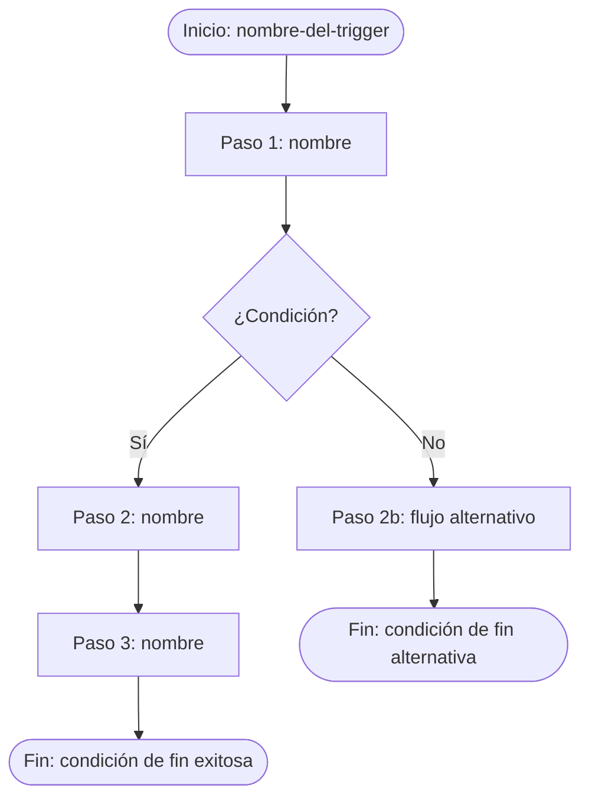

# Proceso: [Nombre completo del proceso]

<!-- 
  PLANTILLA v1.0 — Skill: process-modeler
  Generada automáticamente. Revisar todos los campos marcados con [placeholder].
  Eliminar comentarios HTML antes de publicar.
-->

---

## Metadatos

| Campo | Valor |
|-------|-------|
| **ID** | PROC-[AÑO]-[NNN] |
| **Versión** | 1.0 |
| **Estado** | Borrador |
| **Práctica ITIL 4** | [Nombre de la práctica — ver itil4-practicas.md] |
| **ID Práctica ITIL 4** | [S/G/T + número] |
| **Criticidad** | Alta / Media / Baja |
| **Dueño del proceso** | [Rol, no persona] |
| **Fecha de creación** | YYYY-MM-DD |
| **Última revisión** | YYYY-MM-DD |
| **Revisado por** | [Rol] |
| **Producto del catálogo** | [Nombre del producto — dejar vacío si no aplica] |

---

## Objetivo

> [Una oración precisa con estructura: "Garantizar que [QUÉ] ocurra cuando [CUÁNDO/TRIGGER],
> produciendo [RESULTADO] para [BENEFICIARIO]."]

---

## Alcance

**Incluye:**
- [Actividad o situación dentro del alcance]
- [...]

**Excluye:**
- [Actividad o situación fuera del alcance]
- [...]

**Condiciones de aplicación:**
- [Entorno, sistema o contexto donde aplica este proceso]

---

## Disparador

| Campo | Detalle |
|-------|---------|
| **Evento/Condición** | [Qué inicia el proceso: solicitud, alerta, calendario, etc.] |
| **Origen** | [Sistema, persona o proceso que genera el trigger] |
| **Frecuencia esperada** | [Por demanda / Diario / Semanal / Mensual / Ad hoc] |
| **Canal de entrada** | [Jira, correo, Slack, API, formulario, etc.] |

---

## Flujo del proceso

### Diagrama

<!-- 
  Convenciones BPMN 2.0 en Mermaid:
  ([texto])    → Evento (inicio/fin)
  [texto]      → Tarea
  {texto}      → Gateway (decisión XOR o AND)
  [[texto]]    → Subproceso
  -->

---

### Pasos detallados

<!-- Repetir este bloque por cada paso del proceso -->

#### Paso 1: [Nombre descriptivo]

| Campo | Detalle |
|-------|---------|
| **Tipo BPMN** | Task |
| **Descripción** | [Qué se hace exactamente en este paso] |
| **Responsable (R)** | [Rol que ejecuta] |
| **Accountable (A)** | [Rol que responde por el resultado — uno solo] |
| **Entradas** | [Dato / Servicio / Artefacto que se consume] |
| **Salidas** | [Dato / Artefacto / Estado que se produce] |
| **Herramientas / Sistemas** | [Aplicación, API, servicio utilizado] |
| **Automatizable** | Sí / No / Parcialmente |
| **SLA del paso** | [Tiempo máximo permitido — ej: < 30 min] |
| **Notas / Reglas** | [Validaciones, condiciones, excepciones propias de este paso] |

---

#### Paso 2: [Nombre descriptivo]

| Campo | Detalle |
|-------|---------|
| **Tipo BPMN** | Task / Gateway / Sub-process |
| **Descripción** | [...] |
| **Responsable (R)** | [...] |
| **Accountable (A)** | [...] |
| **Entradas** | [...] |
| **Salidas** | [...] |
| **Herramientas / Sistemas** | [...] |
| **Automatizable** | Sí / No / Parcialmente |
| **SLA del paso** | [...] |
| **Notas / Reglas** | [...] |

<!-- Continuar con más pasos según sea necesario -->

---

## Matriz RACI

| Paso | [Rol 1] | [Rol 2] | [Rol 3] | [Rol N] |
|------|---------|---------|---------|---------|
| Paso 1: [nombre] | R | A | C | I |
| Paso 2: [nombre] | I | A | R | — |
| Paso N: [nombre] | C | A | R | I |
| **Proceso completo** | C | **A** | R | I |

**Leyenda:** `R` Responsible · `A` Accountable · `C` Consulted · `I` Informed · `—` No participa

> ⚠️ **Validaciones RACI:**
> - Cada paso tiene exactamente un **A**
> - El proceso completo tiene exactamente un **A** global
> - No existe ningún paso sin al menos un **R**

---

## Entradas y salidas del proceso

### Entradas globales

| Entrada | Tipo | Proveedor | Formato | Obligatoria |
|---------|------|-----------|---------|-------------|
| [Nombre] | Dato / Solicitud / Credencial / Configuración / Documento | [Servicio o producto que la provee] | JSON / YAML / Formulario / Ticket / etc. | Sí / No |

### Salidas globales

| Salida | Tipo | Consumidor | Formato | Evidencia generada |
|--------|------|------------|---------|-------------------|
| [Nombre] | Artefacto / Notificación / Reporte / Estado / Configuración | [Servicio, producto o rol que la consume] | [Formato] | Log / Ticket / Captura / Bitácora |

---

## Condiciones de fin

### Fin exitoso
- [Condición 1 que indica que el proceso terminó correctamente]
- [Condición 2 — puede ser un estado en un sistema, un artefacto generado, etc.]

### Fin por excepción / fallo
- [Condición que determina que el proceso terminó con error]
- [Acción a tomar en este caso: escalar, reiniciar, abrir incidente, etc.]

### Flujos alternativos documentados
| ID | Condición | Paso donde ocurre | Resultado |
|----|-----------|-------------------|-----------|
| ALT-01 | [Descripción de la condición] | Paso N | [A dónde va el flujo] |

---

## Riesgos del proceso

| ID | Descripción del riesgo | Categoría | Probabilidad | Impacto | Control | Tipo de control |
|----|------------------------|-----------|-------------|---------|---------|-----------------|
| R01 | [Descripción clara del riesgo] | Técnico / Operativo / Seguridad / Disponibilidad / Organizacional | Alta / Media / Baja | Alto / Medio / Bajo | [Descripción del control] | Preventivo / Detectivo / Correctivo / Automatizado |

---

## KPIs e indicadores

| ID | Indicador | Fórmula / Métrica | Frecuencia | Meta | Sistema de medición |
|----|-----------|-------------------|------------|------|---------------------|
| KPI-01 | Tiempo de ciclo del proceso | Tiempo entre trigger y condición de fin exitosa | Por ejecución | < [X] min | [Herramienta] |
| KPI-02 | Tasa de éxito | (Ejecuciones exitosas / Total ejecuciones) × 100 | Mensual | > [X]% | [Herramienta] |
| KPI-03 | [Indicador específico del proceso] | [...] | [...] | [...] | [...] |

---

## SLA del proceso

| Nivel | Tiempo máximo | Condición |
|-------|--------------|-----------|
| Resolución | [X horas/minutos] | Desde el trigger hasta el fin exitoso |
| Primera respuesta | [X minutos] | Desde el trigger hasta el Paso 1 completado |
| Escalación | [X horas] | Si no hay respuesta en [tiempo] |

---

## Integración con el catálogo de productos

<!-- Eliminar esta sección si el proceso no pertenece a un producto del catálogo -->

| Campo | Valor |
|-------|-------|
| **Producto padre** | [Nombre del producto en el catálogo] |
| **Tipo de proceso** | Operativo / Soporte / Gobierno / Entrega / Aprovisionamiento |
| **Posición en cadena de valor** | Diseño / Arquitectura / Desarrollo / Pruebas / Implementación / Operación / Soporte / Retiro |
| **Consume productos del catálogo** | [Lista: Producto A, Producto B] |
| **Produce para productos del catálogo** | [Lista: Producto X, Producto Y] |
| **Procesos relacionados** | [PROC-YYYY-NNN: nombre del proceso relacionado] |

---

## Historial de versiones

| Versión | Fecha | Autor (Rol) | Cambios |
|---------|-------|-------------|---------|
| 1.0 | YYYY-MM-DD | [Rol] | Versión inicial |

---

## Auditoría del documento

| Verificación | Estado |
|-------------|--------|
| Todos los pasos tienen entrada y salida definida | ✅ / ⚠️ / ❌ |
| Cada paso tiene exactamente un Accountable en RACI | ✅ / ⚠️ / ❌ |
| El diagrama Mermaid refleja todos los pasos y gateways | ✅ / ⚠️ / ❌ |
| Existe al menos un KPI medible con meta definida | ✅ / ⚠️ / ❌ |
| El proceso está clasificado en una práctica ITIL 4 | ✅ / ⚠️ / ❌ |
| Las entradas/salidas referencian servicios o productos reales | ✅ / ⚠️ / ❌ |
| Existen riesgos documentados con al menos un control | ✅ / ⚠️ / ❌ |
| La condición de fin está definida (éxito y fallo) | ✅ / ⚠️ / ❌ |

**Nivel de completitud:** X/8
